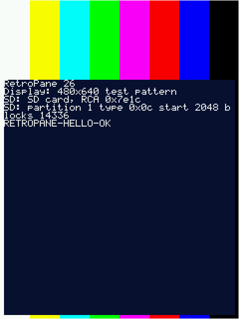

# RetroPane OS

A new, open-source operating system for the **Dell Axim X51v**: a modern take
on Windows Mobile. The first release is **RetroPane 26**.

- **Native drivers for all of the hardware**, reverse-engineered where no
  documentation exists, including the Intel 2700G 3D, 2D and video blocks and
  the built-in Wi-Fi.
- **Runs Windows Mobile 5 and 6.x apps** unmodified. DoomGLES, HereticGLES,
  Cube and Quake 3 are the benchmark.
- **Modern internet:** TLS 1.3, **WPA3** (SAE with protected management
  frames) with WPA2 for older networks, IPv6, and a browser that does as much
  as possible on the device itself.
- **Secure by design:** memory-safe Rust, W^X, every parser fuzzed, signed
  updates and add-on packs, and development-only access that never ships
  ([security](docs/security.md)).
- **Faster than stock:** full 624 MHz, DMA everywhere, compressed RAM, and the
  goal of beating the original drivers.
- **Zero extra hardware:** an X51v, its stock USB cradle, the SD card already in
  it, and a PC. It boots from the SD card and overwrites nothing.

> **Status: Phase 2 (kernel).** No usable OS yet. RetroPane boots on the real
> X51v from the SD card, and a resident loader takes new builds over USB.
> The display, SD and SDHC cards (32 GB tested) and USB work on the device; CompactFlash,
> audio, keys, touch and the backlight work in the emulator, with device runs
> next. The kernel runs processes with protected memory, demand paging,
> compressed RAM and fast message passing in the emulator. See the
> [roadmap](docs/ROADMAP.md).



Everything is judged through four lenses: 🔁 **iterate** · ✨ **modernize** ·
🗄️ **legacy support** · ⚡ **better/faster**.

## The look (in design)

- **A PDA, proudly.** Organiser, capture, reading and media, with two card
  slots. It doesn't pretend to be a phone.
- **An ode to Windows Mobile:** the title bar with Start at the top left, a
  real Start menu, softkeys, and the Today screen, all modernised.
- **Weather is the desktop.** A large forecast blends into the wallpaper,
  with today's calendar, tasks and quick buttons (Note, Record, Reader,
  Media, Games) below it. Time, battery and Wi-Fi are always visible.
- **Smoked glass over a wallpaper you choose:** dark, tinted glass panels
  with fine bright edges over photography, a retro and modern mix in the
  spirit of the glassy desktop art of the late 2000s. A few wallpapers ship
  with it, or you can use your own from either card.
- **Stylus and D-pad equally**, with the buttons doing what they did on
  Windows Mobile.
- **Fast on a 624 MHz CPU:** tinted glass with no blur, composed once and
  cached, with only the changed parts redrawn.

Details: [UI direction](docs/ui/README.md).

## Documents

- [Design document](docs/DESIGN.md)
- [Roadmap](docs/ROADMAP.md)
- [UI direction](docs/ui/README.md)
- [Security](docs/security.md)
- [Architecture decision records](docs/adr/)
- [Clean-room and reverse-engineering policy](docs/CLEANROOM.md)
- [Hardware inventory and prior work](docs/research/hardware-inventory.md)
- [Contributing](CONTRIBUTING.md)

## Building

You need [rustup](https://rustup.rs). The pinned toolchain installs itself.

```bash
cargo xtask ci      # fmt, clippy, architecture lint, unit tests, X51v cross-build
cargo xtask emu     # boot every image in the X51v emulator and check it
cargo xtask bench   # deterministic benchmarks vs the committed baseline (docs/perf.md)
cargo xtask qemu    # (optional) build the emulator locally in WSL for emulator development
```

## License

GPL-2.0-or-later. See [LICENSE](LICENSE).

RetroPane is an independent clean-room project. It is not affiliated with or
endorsed by Microsoft, Dell or Intel, and it contains no code from them.
"Windows Mobile" is a trademark of Microsoft, used here only to describe
compatibility.
