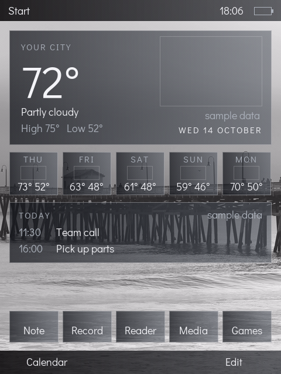

# The Today screen on the Axim: from today's test screen to the mock-up

Plan for a vote (owner, 2026-10-17: "put the real Today screen on the Axim").
Nothing here is built. The look is [ui.md](ui.md); the pictures are in
[mockups/](mockups/README.md); the shell is ADR-0021.

## What runs on the device now

`rp-today` (ADR-0021) already runs on the real X51v under the loader: the
glass title bar with Start, a clock panel, one weather panel with a fixed
reading, one calendar line, five quick buttons, the two softkeys, the Start
menu, touch and the D-pad. It draws into a 480 x 640 layer over a wallpaper in
the video plane. It is the right frame; it lacks the weather look.

## What the mock-ups have that it lacks

| Mock-up | Today screen now | Needed |
|---|---|---|
| Large weather icon breaking out of the hero panel | none | an icon loaded from the pack, drawn over the panel edge |
| Five-day forecast row with small icons | none | five small icons and day, high, low text |
| Weather as the sky (wallpaper) | one fixed wallpaper | wallpaper chosen from the card |
| Calendar with real lines | "No appointments today" | a calendar source (later: iCal, [apps-and-packs.md](apps-and-packs.md) section 7) |
| Pack and wallpaper choice | none | a Settings choice, remembered |

## The steps, in order, each small and device-proven

1. **T1, the layout. Built and emulator-verified (2026-10-17); not yet run on the device.** Hero panel (city, temperature, condition, high and low,
   date), forecast row and calendar panel as in the mock-up, with a plain
   placeholder in place of each icon. Host tests for layout and hit targets;
   `emu-today` pixel check. No new data format.
2. **T2, icons from the card.** One icon format, a pack folder on the card, the
   shell loads the six icons the screen shows. First pack: VClouds' icons (assets/weather/vclouds).
3. **T3, wallpaper from the card.** Same idea for the picture in the video
   plane; falls back to the built-in wallpaper when the card is missing.
4. **T4, a choice.** Settings page: pick the wallpaper and the icon pack; the
   choice is saved on the card.

Weather data is a fixed reading until the networking phase; the screen says
so ("sample data") rather than pretending.

T1 as built: the hero panel (place, temperature, condition, high and low, the
date, an outline where the icon goes), the five-day row, a calendar panel with
sample lines, and the quick buttons at the bottom; the clock moved to the title
bar only, as in the mock-ups. The degree sign was added to the two small fonts
(two glyphs; the image is 613,805 bytes against its 640,000 byte budget). Left and right on the D-pad now
stay on their row, because the quick row sits just above the softkeys. All of
the weather and calendar text says "sample data". Checked by 20 host tests and
`cargo xtask emu-today` (pixel-exact against the shell's own renderer, the
date and clock areas masked).

## The icon format (the one design decision)

The mock-up icons are PNGs with transparency. The device should **not** decode
PNGs: a decoder is code to fit in the flash and a parser to attack
([security.md](../security.md)). Instead a PC tool turns each icon into a raw
file at the two sizes the screen uses, **176 px for the hero and 66 px for the
forecast row, each from the original at its exact aspect ratio, never
stretched or squeezed**. The file is a 16-byte header (magic, width, height,
format) and straight ARGB pixels, which is what `rp_draw::Image` already
draws.

| | One icon | 22 icons |
|---|---|---|
| Hero 176 x 176, ARGB8888 | 124 KB | 2.7 MB |
| Forecast 66 x 66, ARGB8888 | 17 KB | 0.4 MB |
| In RAM at once (1 hero + 5 small) | 124 + 5 x 17 = about 210 KB | |

So a pack is about 3.1 MB on the card (nothing on an 8 GB card) and about
210 KB of RAM, against the shell's 3 MiB allotment ([memory-budget.md](../memory-budget.md)).
The loader checks the header against the file size and refuses anything
that does not match exactly; a damaged icon shows the placeholder, never a
crash. A later step can store 4444 pixels to halve both numbers if the
RAM or the card read time ever matter; it is not needed to start.

## The questions asked of this step

- **Clever, or just copying?** The clever part is not shipping a decoder at all
  and sizing icons on the PC; copying WM would mean a decoder on the device.
- **Smaller?** Yes: no decoder, and only the six visible icons in RAM.
- **Modernized?** Packs and wallpapers are swappable from the card, as the
  design promised.
- **Security:** one fixed header, exact length check, bounds-checked draw,
  and a fuzz test on the loader.
- **Budget:** the shell grows by the layout code (a few KB) and the icon
  loader (about 1 KB); to be reported against the shell's allotment at each
  step.

## Device runs

T1 is verified in the emulator first. Each step then needs one device run,
and none starts until the owner says go, with the numbered steps given
beforehand.
