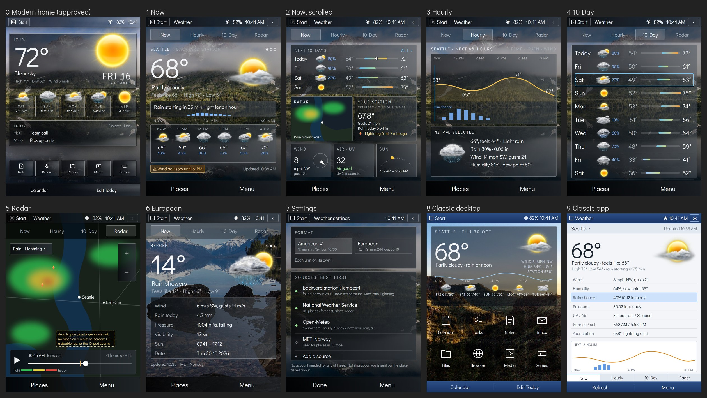

# Weather: screens and flows

Part of the design area: [README.md](README.md). **A draft for the owner's
vote (2026-10-30), nothing decided yet.** The choices are numbered
WF1-WF10 at the end. It builds on the interaction foundations
([interaction.md](interaction.md), their votes I1-I12) and on what is
decided: the weather screen is the default home, the weather is the
hero, the sky is the wallpaper, VClouds' icons keyed by WMO codes, US
units, "sample data" shown until the network exists ([ui.md](ui.md),
[weather.md](weather.md), [today-screen-plan.md](today-screen-plan.md)).

## The owner's direction (2026-10-30, later the same day)

His words: "these are going to need to be pretty unique as there is not
really an SPB or WM equivalent." His direction, to confirm screen by screen
on the mock-ups (thinking aloud is not yet a vote):

- **Modern:** the home page already mocked up (`mockups/today-clear.jpg`)
  is the default home; tapping its weather opens the full-screen app.
- **The app:** modern features, data from popular open sources and from
  hyperlocal ones such as Tempest; at least a 10-day forecast, an hourly
  forecast and a radar view; American and European formats selectable.
- **Classic:** a desktop-skin style weather widget (as Rainmeter skins
  look on a Windows desktop: our own art) over the top half of a Windows
  Mobile-style desktop, customisable icons below it; tapping the widget
  opens the same Weather app.

This replaces WF1 and WF2's options below, and the sketches under "The
screens" are kept only as the earlier draft. **The mock-ups of the
proposal** (sheet `mockups/weather-sheet.jpg`, each screen
`mockups/weather-*.jpg`):



**Ruled by the owner, later the same day, for every app (ui.md):** the apps look
the same in Classic and Modern; only the desktop, and so the way into
the app, differs. So the app is screens 1-7 in both looks, and screen 9
(Classic's own app skin) is set aside.
**The WM-lens ruling (owner, 2026-10-30, ui.md) doesn't apply here:**
"there is no default WM weather app", so Weather keeps its own design,
screens 1-7, the same under both desktops. **For comparison only (the
owner asked what Claude would draw):** Weather as a WM5 program in the
retro-modern look, `mockups/weather-wmlens-sheet.jpg` (Now as a details
list, Hourly as a list of hours, 10 Day, Radar with Play on the left
softkey, the Menu open); it replaces nothing.
**The mix (owner asked, 2026-10-30: "a mixture of your modern and classic
ideas? I like the different buttons being at the bottom"):**
`mockups/weather-mix-sheet.jpg`: Windows Mobile's frame (title bar with
ok; a header strip with the place, its dots, any alert and the data's
time; the view tabs and the softkeys together at the bottom) around the
modern content (the big reading, next-hour rain, the hourly strip and
graph, cards, the 10-day bars). The radar on three real base maps drawn
on the PC from Natural Earth (public domain) and open elevation tiles:
Night (dark), Ink (black water, white land), Relief (tinted by height);
the look is a Menu choice. Map drawing script:
`tools/mockups/radar_basemaps.py` (data in `local/maps/`, not committed). The owner likes the real-data
maps (2026-10-30); proposed: Ink in light mode, Night in dark mode
(ui.md "Light and dark, from the start"). Classic reaches the app from its
desktop widget (screen 8), Modern from the home page (screen 0).

### The full-screen app, proposed (screens 1-7)

- *(Superseded by the owner's direction above: one app, one design.)*
  **One app, two skins.** Classic and Modern open the same app with the
  same four views; Modern draws it as smoked glass over the sky at
  finger scale, Classic as a light Windows Mobile 5-style window at
  stylus scale (screen 9). One set of data, one set of flows, two
  layouts: the theme engine carrying layout, as decided.
- **Four views in a tab row: Now, Hourly, 10 Day, Radar.** Tabs rather
  than one endless page, because the D-pad and the stylus both need a
  short way to each, and each view fills the screen when it is chosen.
  Places by swiping sideways (Modern) or the place line (Classic);
  softkeys Places and Menu (Modern), Refresh and Menu (Classic).
- **Now** (screens 1-2): the reading large; **the next hour's rain
  minute by minute** ("Rain starting in 25 min"); the hourly strip; an
  alert chip; scrolled down: the next 10 days with range bars, a live
  radar thumbnail, **your station** (Tempest), wind, air and UV, sun and
  moon. Each card can be hidden or moved.
- **Hourly** (screen 3): 48 hours as one graph (temperature, rain
  chance, wind) panned sideways, an hour picked by dragging or by the
  D-pad filling a card below. One picture panned is what option D's
  display panning does for free.
- **10 Day** (screen 4): a row a day with low and high on one shared
  scale, so a cold snap shows as a bar out of line; a row opens its
  hours.
- **Radar** (screen 5): the past hour and the next as a loop with a
  scrubber, rain and lightning layers. **The panel feels one point**, so
  no pinch: zoom by + and &minus;, a double tap, or the D-pad.
- **Formats** (screens 6-7): one switch, American (&deg;F, mph, in,
  12-hour, month/day) or European (&deg;C, m/s or km/h, mm, hPa, km,
  24-hour, day.month), then any unit on its own.

### Sources (proposed)

Open, no account, in order of trust, each piece of the screen from the
best source that has it:

| Source | What it gives | Where |
|---|---|---|
| **Your own stations** (Tempest and the rest: below) | now: temperature, wind, rain, pressure, lightning, every minute or so | on the home network directly; away from home through the maker's web service with your own key |
| National Weather Service | forecast, alerts, radar for US places | keyless, US government data |
| Open-Meteo | hourly, 10 days, next-hour rain (15-minute steps), air quality, WMO codes everywhere | keyless for non-commercial use (its terms to check) |
| MET Norway | forecast for European places | keyless with an identifying User-Agent |

### Your own weather stations (owner, 2026-10-30)

The owner: "I want this to be as incorporated as possible and the people
that are going to side load this will be pretty techy anyways. Also lets
add any other weather station integration that is available." So every
station with an open way in is supported, **local first, cloud second**:
on the home Wi-Fi the device reads the station directly (faster, private,
works with the internet down); away from home it reads the maker's web
service with the owner's own key. The switch is automatic.

What each brand offers (as remembered, every row to check before code:
R125):

| Station | On the home network | Through the maker's web service |
|---|---|---|
| **Tempest (WeatherFlow)** | the hub's UDP broadcast, readings every minute, rain and lightning as events | REST and a live WebSocket, with a personal access token made in the Tempest web app |
| **Ambient Weather** | some consoles push to a local server address (custom upload) | AmbientWeather.net REST and realtime, an API key plus an application key |
| **Ecowitt** (and stations sold under other names on its gateways) | the gateway's local HTTP API, and its "customized upload" push | Ecowitt's cloud API, an application key plus an API key |
| **Davis** (WeatherLink Live / Console) | WeatherLink Live's local HTTP and UDP live data | WeatherLink v2 API, a key and a secret |
| **Netatmo** | none known | its web API, signed in with OAuth (the one sign-in flow here) |
| **Weather Underground stations** (any brand that uploads there, including your own) | none | the station owner's PWS API key |
| **PurpleAir** (air quality) | the sensor's local JSON page | PurpleAir's API key (also public sensors near you) |
| **Home Assistant** (anything it knows: most brands, rtl_433 radio sensors, homemade) | its REST API with a long-lived token, on the home network or the owner's Tailscale (apps-and-packs.md §7c) | the same, through Tailscale |
| **WeeWX, Cumulus, Weather Display** (station software on a home PC) | their live data files over HTTP | |
| **Generic** | any URL returning JSON, with the fields mapped once in Settings | |
| Nearby official stations (NWS observations) | | keyless, US, already a forecast source |

**Keys, done safely** (security.md): a key is entered once and stored in
the device's protected store, never shown again in full, sent only to its
own service over TLS, and listed in Settings with what it can see and a
"forget" button. **Typing a 40-character key on a PDA keyboard is the
weak spot**, so keys also arrive by a file on the SD card (read once,
then the device offers to delete it) or from the PC companion
(LegacySync, ADR-0028). No key ever goes in this repository; for
development the owner keeps his in `local/` (never committed), and only
he types or copies it, never Claude.

**Which ones, and how each is proven (owner, 2026-10-30):** "I would like
to add any of the large ones that we can that are easy enough, but I will
only be able to test out tempest." So the first set is the large, open
ones: **Tempest, Davis WeatherLink Live, Ecowitt, Ambient Weather,
Netatmo, Weather Underground stations**, plus **Home Assistant and generic
JSON** as the catch-all for everything else (most brands reach Home
Assistant). Proof comes in three levels, and the app says which level a
station has reached, so nobody is misled:

| Level | How it's proven | Stations |
|---|---|---|
| **Proven** | the owner's own station, on the X51v (the proven-on-hardware rule) | Tempest |
| **Checked with live data** | real stations' public data, read on the X51v (no account of ours needed) | Weather Underground public stations, PurpleAir public sensors, NWS observations |
| **Checked against the maker's documents** | the maker's published sample replies played to the app on the PC and in the emulator, and a stand-in that answers like the station's local interface | Davis, Ecowitt, Ambient, Netatmo, Home Assistant |

A station at the third level shows "Not yet tried with a real station" in
Settings beside it, and the first user with one is asked to send a
report (a log line, no keys in it).

**Several stations at once, ours beyond the original:**
- Each station gets its own card (yours, a neighbour's on Weather
  Underground, the official one); "now" comes from the freshest station
  nearest the place.
- **A sensor reading off is caught:** each station is compared with its
  neighbours and the forecast's "now"; a thermometer in the sun reading
  8&deg; high, or a rain gauge stuck at zero in a storm, is flagged on its
  card and left out of "now" until it agrees again.
- The station's readings move the forecast's next hours (above), and its
  lightning and rain-rate feed the radar and alerts.

**Ours, beyond the original:**
- **Your station corrects the forecast's next hours.** When the
  station reads 2&deg; warmer than the model's "now", the next hours are
  moved by that difference, fading to the model's own values over a few
  hours: a cheap correction that makes the hourly line right for your
  own yard.
- **Lightning from your own station** in the radar's layer and as a
  notice ("Lightning 6 mi"), which no 2005 device could have.
- **Radar pictures arrive as PNG images**, so the app needs the same
  validating PNG reader weather.md already plans for user icon packs (no
  second decoder); every reply is still hostile input (security.md).
- The source choice is its own ADR (WF5): privacy, terms, security.

### Pushback, for the owner to weigh

- **The softkeys on the Classic desktop:** Calendar and Edit Today
  (decided 2026-10-12), against interaction.md's rule I6 (right softkey
  = Menu). Proposed: home screens keep the decided pair as an exception
  named in I6.
- **Radar costs the most of anything here:** a loop of 12-24 map
  pictures per refresh over 802.11b. Proposed: fetched only while the
  Radar view or its thumbnail is on screen, never in the background.

## What the finding is

- **Windows Mobile 5 had no weather program** (weather.md). Its nearest
  pattern for a program with several views is Calendar (Agenda, Day,
  Week, Month, Year; left softkey New, right softkey Menu, views from the
  menu and a row at the bottom: a claim, to check on the owner's X51v,
  R124). Classic's Weather is designed as "what WM5 would have shipped",
  in that pattern.
- **SPB Mobile Shell** had a weather panel among its swiped home panels
  (titled "Weather" in its demo video, ui.md); its details are not in our
  notes yet: the owner's screenshots, or the demo stepped through again,
  fill them in before Modern's mock-up (WF10).
- **What every modern weather app converged on** (a finding, not a
  template): now at a glance, an hourly strip, a list of days, several
  places swiped between, the age of the data shown.

## Where the weather appears

1. **The home screen** (the default home, decided): the hero (place, now,
   condition, high and low, the icon breaking out of the glass), the
   five-day row, the sky as the wallpaper. Built as T1/T2 for Classic's
   arrangement (`rp-today`).
2. **The Weather program:** now in detail, hourly, days, places,
   settings.
3. **The lock screen:** the sky behind it, if chosen (decided, ui.md).

## The screens

### Classic (WM5's pattern, modernised)

```
+------------------------------------------+
| Start   Weather          9:41 AM  W  BAT |  title bar (36)
+------------------------------------------+
| Seattle                          < 1/3 > |  place, which of how many
|  [icon]   72°   Partly cloudy            |
|           Feels like 70°  H 75° L 52°    |
|  "Rain from 3 PM"                        |  the one-line summary
|------------------------------------------|
| Wind 8 mph NW      Humidity 64%          |  details: two columns
| Rain chance 40%    UV 3                  |
| Sunrise 7:52 AM    Sunset 5:58 PM        |
| Pressure 30.02 in  Visibility 10 mi      |
|------------------------------------------|
| Updated 9:40 AM · sample data            |
+------------------------------------------+
|  Now  |  Hourly  |  Days  |  Places      |  view tabs (WM5's tab row)
+------------------------------------------+
| Refresh                           Menu   |  softkeys (40)
+------------------------------------------+
```

- **Views** as a tab row above the softkeys (WM5's Settings pages used
  this row): Now, Hourly (48 rows, one an hour, scrolled), Days (10 rows),
  Places. Tap or Left/Right on the tab row.
- **Left softkey: Refresh.** **Right: Menu** (Add place, Set as home
  place, Units, Icon pack, About, with VClouds' credit).
- **A day's row opens that day** (its hours, sunrise and sunset); **ok**
  at the title bar's right goes back (I7).

### Modern (SPB's shape, our take)

```
+------------------------------------------+
| 9:41 AM                         W  BAT   |  status (36), pull for the shade
|                                          |
|  SEATTLE              • o o              |  place, dots: 1 of 3
|                                          |
|        [ big icon breaking out ]         |  the sky behind everything
|              72°                         |  Display 76
|         Partly cloudy                    |
|        H 75°   L 52°                     |
|      "Rain from 3 PM"                    |
|                                          |
|  9AM 10AM 11AM 12PM 1PM 2PM 3PM 4PM ->   |  hourly strip, flicked sideways
|  ---------------------------------       |
|  MON  [i]  73° 52°                       |  days, flicked up from here
|  TUE  [i]  63° 48°                       |
+------------------------------------------+
|  Places                        Menu      |  softkeys (56)
+------------------------------------------+
```

- **One page per place, swiped sideways** (as SPB's panels); the dots
  say which.
- **Scroll up** for the days and the details (now's details as glass
  cards under the days).
- **The hourly strip** scrolls sideways on its own (the one sideways
  scroller inside a sideways-swiped page: it takes sideways drags that
  start on it, the page takes the rest).
- **Left softkey: Places** (the list, add, reorder). **Right: Menu**
  (Refresh, Units, Icon pack, About). Refresh is also a pull down at the
  top of the page, as phones do, since the finger is there.
- **The living sky** (W6, decided for v1): the clouds drift at the
  forecast's wind speed and direction, rain or snow at its strength.

## The flows

**F1 First start, no place yet.** The home hero shows sample data
labelled as such and a line "Add your place" (a target). It opens the
Places screen's search: type a city or a US ZIP code (the keyboard, stylus
sized), a list of matches, pick one: it becomes the home place, the
hero shows it. No location finding: the X51v has no GPS, and finding
a place from nearby Wi-Fi sends the networks' names to a company (a
privacy cost we don't take by default).

**F2 The glance (the most common use, by far).** Wake the device or press
Home: the home screen shows now, the five days and the one-line summary.
Nothing to tap. Its job is answered in under a second: do I need a
jacket or an umbrella.

**F3 More detail.** Tap the hero (or Enter on it): the Weather program at
Now for that place. Hourly and Days from the tabs (Classic) or by scrolling
(Modern). A day opens its hours. Back returns to where you came from
(the home screen, if you came from there).

**F4 Places.** Add (F1's search); remove (removed at once, Undo for 5 s:
I6); reorder (Classic: Menu, Move up / Move down, as WM5's lists did;
Modern: drag by a handle, stylus or finger); set the home place (the one
the home screen shows). Up to 10 places *provisional* (memory: each
place's cached forecast is small, below).

**F5 Refresh.** Automatic, on a schedule (WF4), and when the program is
opened if the data is older than the schedule. By hand: Refresh. Never
blocks anything: the old data stays on screen with its age until the new
arrives, and a failure leaves the old data and says so.

**F6 Stale, offline, failed.**

| Situation | What the screen shows |
|---|---|
| Fresh | "Updated 9:40 AM" in DIM |
| Older than 3 h *provisional* | the age in amber, "Updated 6:40 AM" |
| Older than the forecast covers | "No current forecast. Connect to refresh" instead of numbers; never a stale "now" shown as now |
| No network | the data with its age, plus "Offline" |
| The source failed | the data with its age, plus "Couldn't refresh. Try again" (a target) |
| A code with no icon | the pack's `22` (unknown) icon, never a blank |
| Before the network exists | "sample data" (decided) |

**F7 Settings, from Menu:** units (US by default: °F, mph, inches, 12-hour;
metric later, decided), the icon pack (T4), refresh schedule, the sky's
motion on or off (every effect can be turned off, decided).

**F8 Alerts (later, if the source has them):** a severe-weather warning
shows as a band on the hero and a notification; tapping it shows the
warning's text. Waits on the source's design (WF5).

## The D-pad, screen by screen (I8's rules)

| Screen | Up / Down | Left / Right | Enter |
|---|---|---|---|
| Home | between the hero, the five days, the rest of the home screen | along the five days | hero: open Weather; a day: open that day |
| Weather, Now (Classic) | through the details, then the tabs, then the softkeys | on the place line: previous / next place; on the tabs: the views | on a detail: nothing; on a tab: that view |
| Weather (Modern) | scroll the page by focus: the hourly strip, each day, the details | previous / next place, except inside the hourly strip, where they move along the hours | a day: open it |
| Hourly, Days lists | by row | previous / next place | a day: open it |
| Places | by row | nothing (I8: never out of the list) | open that place |

## International (the owner's standing rule, 2026-10-30, design README)

- **Places anywhere:** search by any city or postcode worldwide; the
  place's own time zone for its hours, sunrise and sunset.
- **Sources by country:** Open-Meteo covers the world; each country's
  own national service is used where it is open (the US's NWS, Norway's
  MET, Germany's DWD, Environment Canada and others, each checked under
  R125), the best available winning, as in the US.
- **Alerts by country:** NWS in the US, MeteoAlarm across Europe, each
  national service's warnings elsewhere where open; a place with no open
  alert source says so instead of showing nothing.
- **Formats:** American and European presets, then every unit on its
  own; the date order and 12- or 24-hour clock from the region setting.
- **Names in any script:** place and station names in their own
  writing; where the base font lacks a script, a font pack supplies it
  (ui.md "Fonts the same way").
- **Words:** every word on screen comes from a strings table, so a
  translation is a file, not a code change (English ships first).

## Ours, beyond the original (rule 0)

- **"Now" between refreshes, from the forecast already held.** The
  hourly forecast holds each hour's temperature, wind and rain chance;
  between fetches the screen shows the hour's value moved toward the
  next hour's as time passes, so "now" stays current for hours without
  using the radio. Wi-Fi is the battery's biggest drain on the Axim (a
  claim: power measurements are phase 9's), so fewer fetches is longer
  battery, and an offline device still shows a sensible "now". The
  screen says "Updated ..." from the real fetch, never from the
  estimate.
- **The sun and moon worked out on the device.** Sunrise, sunset, day or
  night icons, the sun's arc in the living sky and the moon's phase come
  from the place's position and the date, with no network: the sky is
  right at 5:58 PM even if the last fetch was at noon.
- **The one-line summary written on the device** from the hourly numbers
  ("Rain from 3 PM", "Colder than yesterday", "Windy this afternoon"): a
  handful of rules over the cached data, nothing sent anywhere.
- **Cached small:** one place's 10 days and 48 hours as packed numbers
  is about 1-2 KB, so 10 places cost about 20 KB of flash and RAM, kept
  through a restart (memory-first rule).
- **The source keyed by WMO codes,** as the icon packs already are
  (weather.md): feeds that send WMO codes (Open-Meteo's does, keyless:
  a finding, the source's choice is its own ADR with privacy and
  security) need no translation table; every reply parsed as hostile
  input (security.md).
- **Fetch when the radio is already on** (when Wi-Fi is up for another
  reason, refresh rides along), so a scheduled refresh rarely wakes the
  radio by itself.

## The votes

- **WF1 Classic's views:** A a tab row (Now, Hourly, Days, Places) above
  the softkeys, Refresh / Menu softkeys (recommended); B views only from
  the Menu (WM5 Calendar's way, one less row).
- **WF2 Modern's layout:** A one page per place swiped sideways, scroll
  up for days and details, hourly strip sideways (recommended); B one
  page with a place picker at the top.
- **WF3 Place finding:** A search by city or US ZIP, no location finding
  (recommended); B also from nearby Wi-Fi networks (sends their names to
  a company).
- **WF4 Refresh schedule:** A every 3 h *provisional*, plus when opened
  if older, plus riding along when Wi-Fi is up (recommended); B every
  hour; C by hand only.
- **WF5 The data source:** decided later in its own ADR (privacy,
  security, WMO codes, US units); this page assumes only hourly and
  daily forecasts with WMO codes. Agree to defer? (recommended: yes).
- **WF6 "Now" from the held forecast between fetches:** A yes, labelled
  by the real fetch's time (recommended); B show only what was fetched.
- **WF7 The one-line summary:** A on the hero and the program
  (recommended); B leave it out.
- **WF8 Places:** A up to 10, one home place (recommended); B a
  different number.
- **WF9 Weather in the Start menu:** A add it after Today (it's the
  home program, and the decided list predates it) (recommended); B leave
  it in Programs.
- **WF10 Next step for the look:** A mock-ups of both looks' screens
  (Now, Hourly, Days, Places, the stale and offline states) drawn by the
  real shell code in `cargo xtask ui-preview` once I1-I12 are voted
  (recommended); B mock-ups as pictures first, code after.
