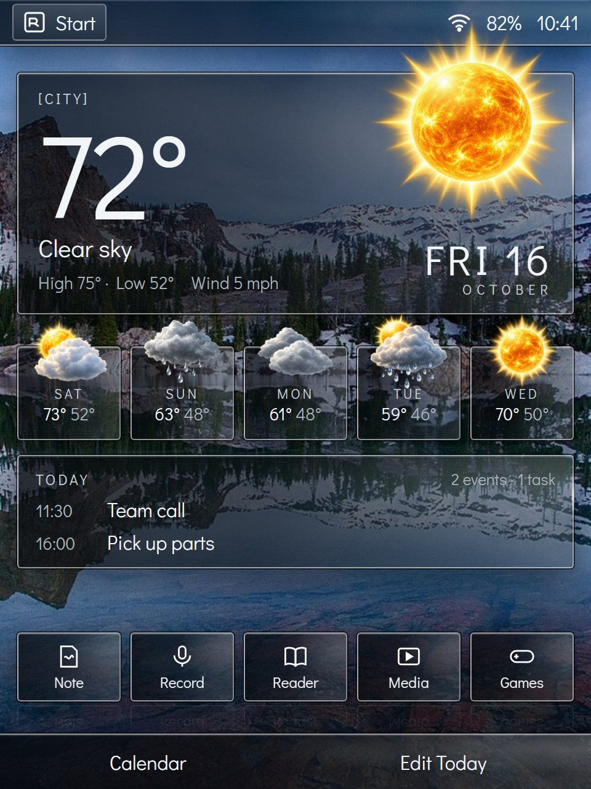
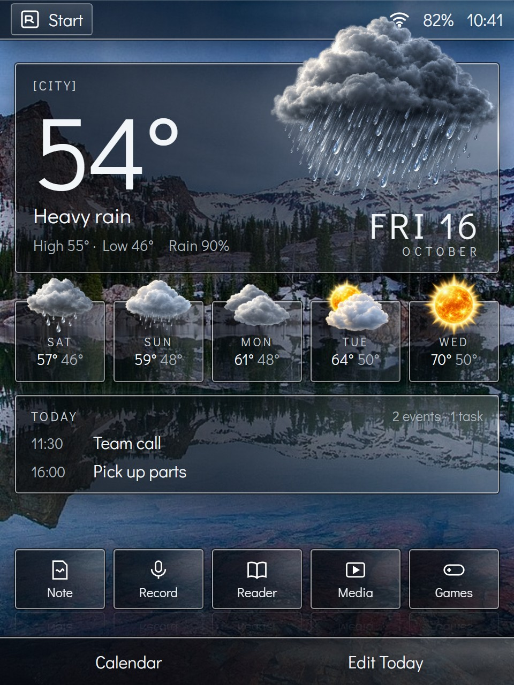
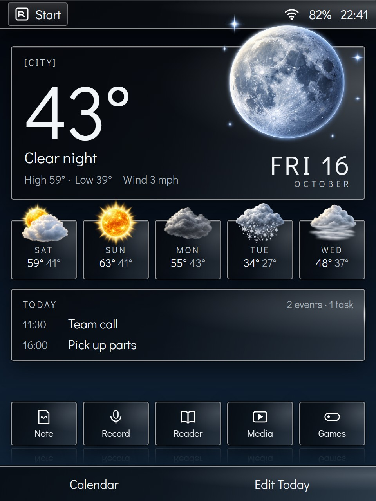
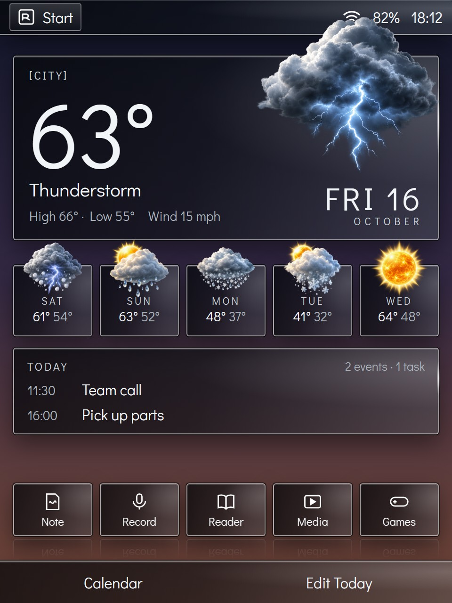
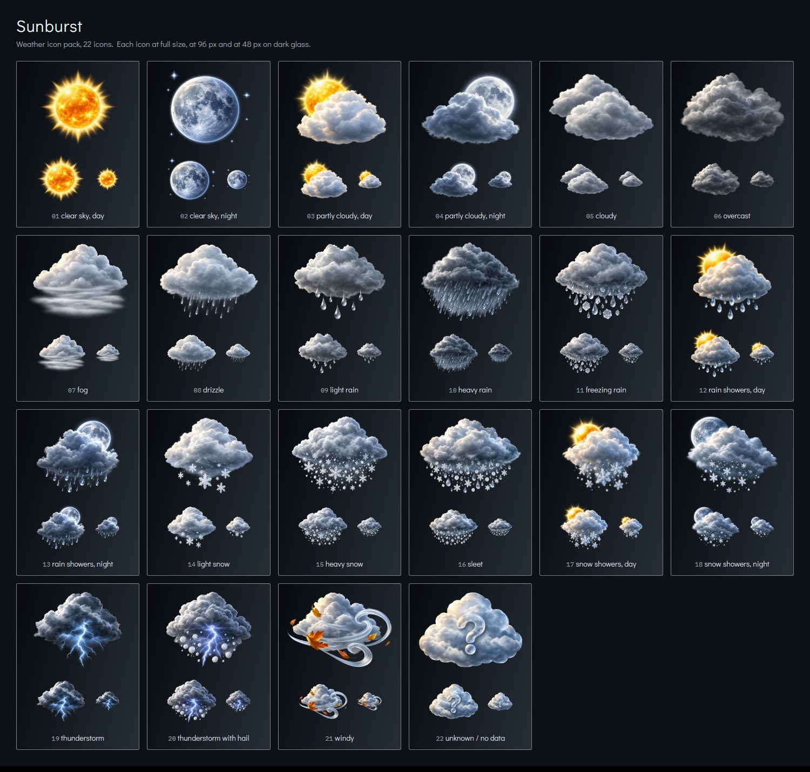

# Weather: the app, the Today screen and the icon packs

A headline feature Windows Mobile never had by default (owner, 2026-10-16).
The look is in [ui.md](ui.md) ("Weather and icons", "The smoked-glass design language", boards N-R); the app list it belongs to is in
[apps-and-packs.md](apps-and-packs.md).

## What it is

- **The Today screen's hero:** the current conditions large, front and
  centre, the sky as the wallpaper, the icon breaking out of its glass tile
  ([ui.md](ui.md)).
- **A Weather app:** now, hourly, days ahead, saved places.
- **Forecast data** over the network once networking lands (ROADMAP
  Phase 6): source, privacy and caching are a design to come; every feed
  is parsed as hostile input (`docs/security.md`).

## Icon packs (decided by the owner, 2026-10-16)

- **One pack in the system** (flash), keeping the base small: the owner's choice.
- **Five more packs** install onto the SD or CF card when one is present,
  from the expansion pack ([ADR-0018](../adr/0018-optional-packs.md),
  [apps-and-packs.md](apps-and-packs.md) §5). With no card, the one
  built-in pack is the only option.
- **Bring your own:** users add their own pack from the card.
- **Where the extra packs come from:** artists' packs with a free licence
  that allows shipping in RetroPane, ones the owner likes (still to find);
  or packs the owner makes. Never icons drawn by Claude. Ruled out by the owner for looks: Meteocons, Erik Flowers'
  Weather Icons, Oxygen, Tango.

### The pack format: keyed by the WMO weather codes

Forecast feeds send a condition *code*, not a picture: the World
Meteorological Organization's weather interpretation codes (the
WMO 4677 family, as the open feeds use them). A pack is a set of pictures
named for the icons below, each covering a group of codes, so any pack that
has every name works. Pictures are square transparent PNGs in the
pack, 512 px or larger and all the same size (1024 or 816 are fine); the build (or the installer, for a user's pack) scales them into the
asset atlas, so they cost nothing while running (design-brief.md). A pack
is data only, checked like any input: size-capped, decoded by our own
validating PNG reader, refused if damaged.

| File | Icon | WMO codes |
|---|---|---|
| `01` | Clear sky, day | 0, 1 |
| `02` | Clear sky, night | 0, 1 |
| `03` | Partly cloudy, day | 2 |
| `04` | Partly cloudy, night | 2 |
| `05` | Cloudy | 3 (thin) |
| `06` | Overcast | 3 |
| `07` | Fog | 45, 48 |
| `08` | Drizzle | 51, 53, 55 |
| `09` | Light rain | 61 |
| `10` | Heavy rain | 63, 65 |
| `11` | Freezing rain | 56, 57, 66, 67 |
| `12` | Rain showers, day | 80, 81, 82 |
| `13` | Rain showers, night | 80, 81, 82 |
| `14` | Light snow | 71, 77 |
| `15` | Heavy snow | 73, 75 |
| `16` | Sleet | mixed rain and snow |
| `17` | Snow showers, day | 85, 86 |
| `18` | Snow showers, night | 85, 86 |
| `19` | Thunderstorm | 95 |
| `20` | Thunderstorm with hail | 96, 99 |
| `21` | Windy | (from wind speed, not a code) |
| `22` | Unknown / no data | anything else |

Open: the exact code-to-file mapping (some codes, such as 3 split into
cloudy and overcast, depend on extra data like cloud cover), and whether a
pack may leave optional icons out (night variants falling back to day).

## Mock-ups (Sunburst pack, 2026-10-16)

The first pack, "Sunburst" (22 icons, made by the owner), on the
Today screen. Credits and licences: [mockups/README.md](mockups/README.md).

<table>
<tr>
<td></td>
<td></td>
</tr>
<tr>
<td></td>
<td></td>
</tr>
</table>

What the mock-ups showed: the icons keep real transparency and clean edges on
any wallpaper, and the sun, moon and clouds stay recognizable at 48 px;
drizzle (08) is the faintest on a bright background.
