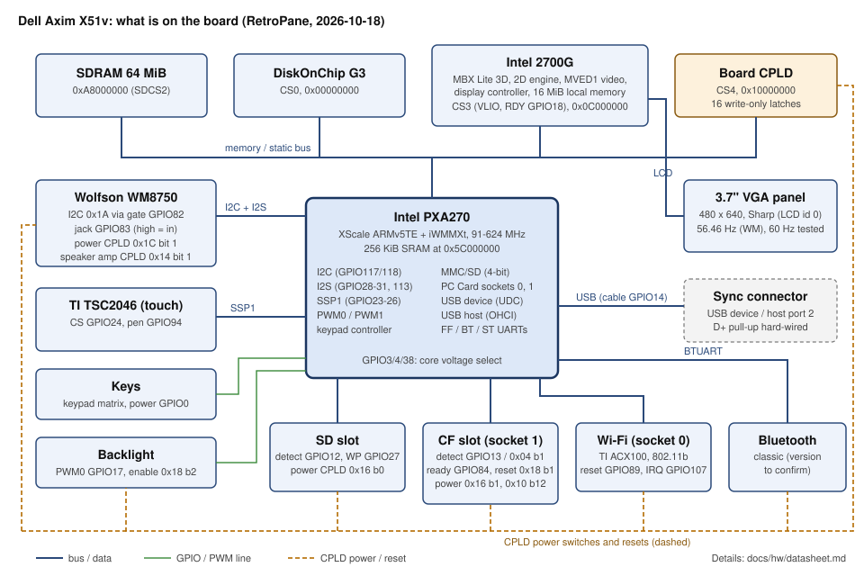
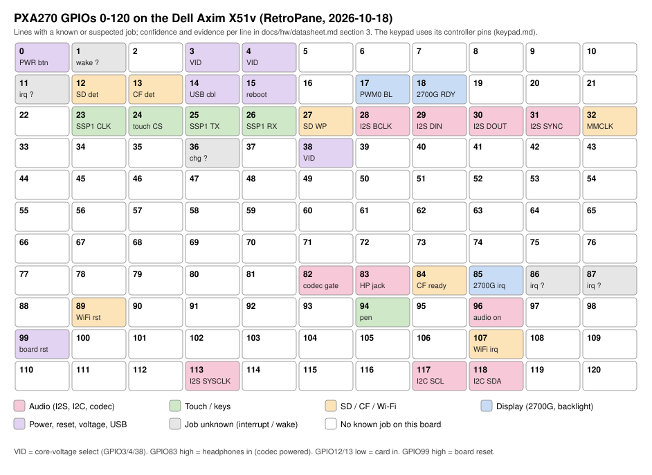
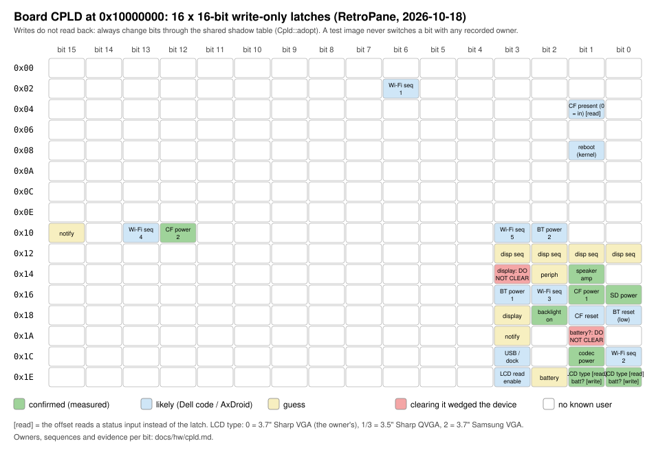

# Dell Axim X51v: the hardware datasheet

Everything RetroPane has established about the Dell Axim X51v (and, where
noted, the X50v), on one page: the board, its memory map, a pinout of the
PXA270's GPIOs as wired on this board, the CPLD's registers, and each
device's interface and quirks. It is a summary: each section links the
page that holds the evidence, and those pages stay the source of truth
(update them, then this).

*As of 2026-10-19 (texture shapes from Dell's GLES library; Bluetooth and USB host from Dell's ROM, the audio service's jack findings, and the Bluetooth radio's power sequence, 2026-10-18). Facts come from measurements on the owner's X51v (a
replacement X50v front bezel), Windows Mobile's own drivers read for facts
only (docs/CLEANROOM.md), Intel's manuals, and AxDroid's board code.*

**Confidence**, as everywhere in `docs/hw`: **confirmed** (measured on the
device, or two independent sources agree), **likely** (one good source, or
code read but not run), **guess** (an inference worth testing),
**unknown**.

## 1. The chips

| Part | What | Interface | Page |
|---|---|---|---|
| Intel **PXA270** (XScale, ARMv5TE, CPU ID `0x69054117`) | the processor: 91-624 MHz, 256 KiB internal SRAM, iWMMXt | — | [clocks.md](clocks.md) |
| 64 MiB **SDRAM** | main memory at `0xA8000000` (SDCS2) | memory controller | [memory-map.md](memory-map.md) |
| **DiskOnChip G3** | built-in flash (Windows Mobile's ROM and file store) | CS0 | [memory-map.md](memory-map.md) |
| Intel **2700G** ("Marathon"): MBX Lite 3D core, 2D engine, MVED1 video decoder, display controller, 16 MiB local memory | graphics; drives the panel | CS3 (VLIO, 32-bit), interrupt GPIO85 | [2700g.md](2700g.md) |
| Board **CPLD** | power switches, resets, the panel type | CS4, sixteen 16-bit write-only latches | [cpld.md](cpld.md) |
| **3.7" VGA panel** (Sharp on the owner's unit, CPLD LCD id 0) | 480 x 640; 56.46 Hz as Windows Mobile drives it, 60.0 Hz measured working (display calibration C3) | the 2700G | [2700g.md](2700g.md), [backlight.md](backlight.md) |
| Wolfson **WM8750** | audio codec: DAC, headphone and speaker outputs, jack detect | I2C (control, `0x1A`), I2S (data) | [audio.md](audio.md) |
| TI **TSC2046** | touch screen controller | SSP1 | [touch.md](touch.md) |
| TI **TNETW1100B (ACX100)** | Wi-Fi, 802.11b | PC Card socket 0 (`0x2C000000`) | [cf.md](cf.md), [../research/hardware-inventory.md](../research/hardware-inventory.md) |
| TI **BRF6150** | Bluetooth **1.2** (no Low Energy, PIN pairing only), firmware 3.0.48, 921,600 baud | BTUART | [bluetooth.md](bluetooth.md) |

## 2. Memory map (physical)

| Base | Size | What | Conf. |
|---|---|---|---|
| `0x00000000` | 64 MiB | CS0: boot ROM / DiskOnChip G3 | confirmed |
| `0x0C000000` | 64 MiB | CS3: 2700G (registers at `0x0FFE0000`: display `+0x2000`, video decoder `+0x3000`, MBX core `+0x4000`; command windows at `0x0FFF0000` (video) and `0x0FFF4000`-`0x0FFF6FFF` (MBX; the 2D stream at `0x0FFF5000`); local memory below) | confirmed |
| `0x10000000` | 1 MiB | CS4: board CPLD | confirmed |
| `0x20000000`-`0x2FFFFFFF` | — | PC Card socket 0 (Wi-Fi) | confirmed (mapped) |
| `0x30000000`-`0x3FFFFFFF` | — | PC Card socket 1 (CompactFlash slot) | confirmed |
| `0x40000000` | 32 MiB | PXA270 peripherals (GPIO `0x40E00000`, I2C `0x40301680`, I2S `0x40400000`, PWM `0x40B00000`, clocks `0x41300000`, DMA `0x40000000`, UDC `0x40600000`) | confirmed |
| `0x4C000000` | 1 MiB | USB host (OHCI) | confirmed |
| `0x5C000000` | 256 KiB | internal SRAM | confirmed |
| `0xA8000000` | 64 MiB | SDRAM (HaRET needs `ramaddr 0xa8000000`) | confirmed |

Full table with Windows Mobile's virtual addresses: [memory-map.md](memory-map.md).

## 3. Pinout: the PXA270's GPIOs on this board

Only lines with a known or suspected job are listed; "fn" is the PXA27x
alternate function. Directions are as the board uses them.

| GPIO | Fn | Dir | Job on the X51v | Conf. | Page |
|---|---|---|---|---|---|
| 0 | 0 | in | **Power button**; reads 0 at rest; both edges wake and interrupt | confirmed | [README](README.md) |
| 1 | 0 | in | a wake source (`PWER` `0x80007803`: GPIO0, 1, 11-14 and the RTC alarm); device unknown | unknown | [probe](probe-2026-10-11.md) |
| 2 | — | — | not the USB D+ pull-up (tried both ways: the pull-up is hard-wired) | confirmed (negative) | [udc.md](udc.md) |
| 3, 4, 38 | 0 | out | **core voltage select** (three levels to the regulator: 1050-1574 mV; GPIO3/4 are the power-I2C pins used as plain GPIOs) | likely (code) | [clocks.md](clocks.md) |
| 10 | 1 | out | **32.768 kHz clock out** (`OSCC` TOUT_EN), most likely the Bluetooth radio's sleep clock | likely | [bluetooth.md](bluetooth.md) |
| 11 | 0 | in | an interrupt, both edges (SYSINTR 18), and a wake source; device unknown | unknown | [interrupts.md](interrupts.md) |
| 12 | 0 | in | **SD card detect**, low = card in | confirmed | [sd.md](sd.md) |
| 13 | 0 | in | **CompactFlash card detect**, low = card in; **sticks at "no card" after a removal until a reset** (use CPLD `0x04` bit 1) | confirmed | [cf.md](cf.md) |
| 14 | 0 | in | USB cable detect (likely); reads 0 in the cradle | likely | [udc.md](udc.md) |
| 15 | 0 | out | driven low in Windows Mobile's software reboot | likely | [README](README.md) |
| 17 | PWM0 | out | **backlight brightness** (PWM0, ~30 kHz) | confirmed | [backlight.md](backlight.md) |
| 18 | RDY | in | the 2700G's VLIO ready | likely | [2700g.md](2700g.md) |
| 23, 25, 26 | SSP1 | — | **touch controller** clock (23), data out (25), data in (26) | likely | [touch.md](touch.md) |
| 24 | 0 | out | **touch chip select**; Windows Mobile leaves it as SSP1's frame (fn 2): set it to a plain GPIO first | confirmed | [touch.md](touch.md) |
| 27 | 0 | in | **SD write protect**, high = locked | likely | [sd.md](sd.md) |
| 28 | 1 | out | **I2S bit clock** | confirmed | [audio.md](audio.md) |
| 29 | 2 | in | **I2S data in** (from the codec) | confirmed | [audio.md](audio.md) |
| 30 | 1 | out | **I2S data out** (to the codec) | confirmed | [audio.md](audio.md) |
| 31 | 1 | out | **I2S frame sync** | confirmed | [audio.md](audio.md) |
| 32 | MMCLK | out | SD clock (seen toggling every ~16 µs) | likely | [2700g.md](2700g.md), [sd.md](sd.md) |
| 36 | — | — | **not** the CF reset (AxDroid's guess); a charger/cradle line, perhaps | unknown | [cf.md](cf.md) |
| 42, 44 | 1 | in | **BTUART** receive (42) and CTS (44), the Bluetooth radio | confirmed (code) | [bluetooth.md](bluetooth.md) |
| 43, 45 | 2 | out | **BTUART** transmit (43) and RTS (45) | confirmed (code) | [bluetooth.md](bluetooth.md) |
| 82 | 0 | out | **codec I2C gate**: high during each codec transfer, low after (never left high: shared) | confirmed | [audio.md](audio.md) |
| 83 | 0 | in | **headphone jack**, high = plugged in, valid only while the codec is powered and set up | confirmed | [audio.md](audio.md) |
| 84 | 0 | in | **CF slot powered / ready**, high | confirmed | [cf.md](cf.md) |
| 85 | 0 | in | **2700G interrupt**, both edges (SYSINTR 27); Windows Mobile's disable leaves it an output driven low: make it an input first | confirmed | [2700g.md](2700g.md), [interrupts.md](interrupts.md) |
| 86/87 | 0 | in | an interrupt, both edges (SYSINTR 34); device unknown | unknown | [interrupts.md](interrupts.md) |
| 89 | 0 | out | Wi-Fi reset | likely | [cpld.md](cpld.md) |
| 94 | 0 | in | **touch pen-down**, low while touched (falling edge, SYSINTR 17) | likely | [touch.md](touch.md) |
| 96 | 0 | in | reads 1 whenever audio is powered (not the jack: measured); both edges, SYSINTR 39 | confirmed (meaning unknown) | [audio.md](audio.md) |
| 99 | 0 | out | **board reset**: driven high, the board resets (Windows Mobile's software reboot) | likely | [README](README.md) |
| 107 | 0 | in | **Wi-Fi interrupt**, falling | confirmed (driver) | [interrupts.md](interrupts.md) |
| 113 | 1 | out | **I2S system clock** (the codec's master clock) | confirmed | [audio.md](audio.md) |
| 117 | 1 | — | **I2C clock** (SCL) | confirmed | [audio.md](audio.md) |
| 118 | 1 | — | **I2C data** (SDA) | confirmed | [audio.md](audio.md) |

The keypad uses the PXA27x keypad controller's matrix and direct inputs
(pins as its alternate functions; the key map in [keypad.md](keypad.md)).

## 4. The board CPLD

Sixteen-bit latches at `0x10000000 + offset`. **They can't be read back**:
Windows Mobile's drivers share one shadow copy per register (RAM
`0xA8001320`, ten slots), and RetroPane adopts that table at hand-over
(`Cpld::adopt`). Writing a register blind switches other devices off.

| Offset | Bit | Job | Conf. |
|---|---|---|---|
| `0x04` (read) | 1 | **CF card present when clear** (follows the card both ways, unlike GPIO13) | likely |
| `0x10` | 12 | **CF slot power, stage 2** | confirmed |
| `0x14` | 1 | **speaker amplifier** (70 ms to settle) | confirmed |
| `0x14` | 3 | display (guess); **clearing it, or `0x1A` bit 1, for 1 s wedged the device** (hardware watchdog reset; which of the two is unknown) | guess: never touch |
| `0x16` | 0 | **SD card power** | confirmed |
| `0x16` | 1 | **CF slot power, stage 1** (then `0x10` bit 12, 10 ms apart) | confirmed |
| `0x18` | 1 | **CF RESET** (set = held in reset) | likely |
| `0x18` | 2 | **backlight enable** | confirmed |
| `0x10` | 2 | **Bluetooth power, stage 2** | likely |
| `0x16` | 3 | **Bluetooth power, stage 1** | likely |
| `0x18` | 0 | **Bluetooth reset**, active low (set = running) | likely |
| `0x1C` | 1 | **audio codec power** | confirmed |
| `0x1C` | 3 | **USB / dock**: on in the dock, off out of it (Windows Mobile's shadow, one observation) | likely |
| `0x1E` | 3 (write) / 1-0 (read) | **LCD type readout**: 0 = 3.7" Sharp VGA (the owner's), 1 and 3 = 3.5" Sharp QVGA, 2 = 3.7" Samsung VGA | confirmed |

Other bits with a likely or guessed owner (Wi-Fi's power sequence,
Bluetooth/serial, USB, battery, notification LED, display sequence) are in
[cpld.md](cpld.md). **Rule:** a bit with any recorded owner is never
switched by a test image; an unknown bit only one per run, with the owner
watching.

## 5. Devices

### Display (2700G)
- One graphics plane composed by the 2D engine (ADR-0023), double
  buffered; its interrupt line is GPIO85. Windows Mobile's 648 x 645
  frame at `DISPPLL` `0xEC5` (23.56 MHz) gives 56.46 Hz; 60.0 Hz was
  measured working (display calibration C3).
- **MBX 3D core**: tile-based (8 x 16 px tiles at 32 bpp, 60 x 40 on the
  screen); each object carries an alpha-test word (bits 31-29 compare,
  28-21 reference), a TSP word (Gouraud bit 22, depth mode and write,
  fog bit 24 / no fog bit 25) and texture words (texture code 10 = 8-bit
  grey, code 8 = grey + alpha, code 7 = ARGB4444; full list in 2700g.md);
  all eight depth modes proven (ADR-0026); render done is bit 2 of the
  interrupt status `0x12c`. Textures are twiddled, sides powers of two up
  to 2048, rectangles too (512 x 1024 drawn right, `rp-gpubench`
  2026-10-19); Dell's GLES has no row-order mode. At WM's clock a bare
  tile renders in ~5.3 us, a textured one ~11.3 us, each translucent
  layer adds ~8 us: a full-screen textured layer takes 25-29 ms. A
  `GSCADR` or `VSCADR` repoint takes effect at once (write it in the blanking); a pan by repointing either plane is smooth (`rp-gpubench` run C). The video plane takes the graphics plane's RGB formats too (`VSCTRL` 4-8; RGB565 shown exactly, run D), not only YUV. The CPU's bus to the 2700G (CS3, `MSC1`): Windows Mobile's 17 clocks a beat gives ~33 MB/s writes, 12 MB/s reads; the 2700G paces it with RDY, so 14 clocks gains only ~7% and 13 clocks reads wrong (`rp-cs3bus`, 2026-10-19). An 8-bit grey texture (code 10) draws faster than RGB565 (a full screen 22.7 ms vs 27.2); a 2D blit costs ~14 us of engine time each (`rp-gpubench` run E, 2026-10-20); the 2D engine's 4 bpp coverage blend onto RGB565 runs at ~16 Mpx/s, a small plain copy (12 x 16 px) costs ~8.9 us of which ~6 us is per command, and a scattered single-word CPU write to 2700G memory ~380 ns (run F).
- Panel brightness: PWM0 (GPIO17) up to full duty, Windows Mobile caps it
  at 137/216; PWM1 drives the panel's VCOM (Dell's value 70/216).
- Pages: [2700g.md](2700g.md), [backlight.md](backlight.md),
  ADR-0022/0023/0024/0026.

### Audio (WM8750)
- Control: standard I2C at `0x1A` (fast mode works; standard too), **through
  the gate GPIO82**; power CPLD `0x1C` bit 1.
- Data: I2S master (bit clock and frame from the PXA), 48 kHz proven, by
  DMA (channel map `AUDIO`).
- Outputs: headphones (jack GPIO83) and speaker (amplifier CPLD `0x14`
  bit 1). GPIO83 is high only while the codec is powered, so it falls
  when the codec goes off with headphones in (an edge of our own making),
  and a plug while audio is off likely makes no edge (emulator-modelled;
  device run S1 pending). RetroPane's session rate is **44.1 kHz**
  (ADR-0032 A1: `SADIV` `0x0D`, codec register 8 = `0x020`), **measured at
  44,317 frames a second** (+0.49%, 2026-10-19, against the OS timer).
  `SADIV` is a choice of fixed settings, not a divider, and none is exact:
  `0x0C` 47,795 (-0.43%), `0x0D` 44,317 (+0.49%), `0x1A` 21,959 (-0.41%),
  `0x34` 10,978 (-0.43%); undocumented `0x0B`, `0x0E`-`0x10` act as
  `0x1A`.
- **Traps measured on this board:** the I2C controller can't do
  address-only transfers (a byte with START and STOP never finishes; after
  an acknowledged address a master abort holds SCL low); a switch-on of I2S
  within ~645 ms of a switch-off is ignored (keep I2S on through a session).
- **The audio DMA may stop and restart while I2S runs** (2026-10-19, ADR-0032
  A6's bench, 15 of 15): a stop at a STOP link, left 0-1,000 ms, restarted
  by `DDADR` and `RUN` moves 8 us later (once the FIFO has emptied); I2S stays
  on. An empty FIFO sets `SASR0` `TUR` (bit 5, sticky until `SAICR`), which
  doesn't block the restart.
- **While the engine runs a descriptor whose link has STOP, `DDADR` reads
  that link: the STOP bit and the next descriptor's address bits**
  (2026-10-19, ADR-0032 A6's listening run: the ring's race told apart and
  restarted 5 of 5 by it, none failed). Restarted at once after such a
  stop, the engine played on with no measurable gap (0 us).
- Dell's private equalizer controls: `WAV1:` codes `0x1D2000`/`0x1D2004`.
- Page: [audio.md](audio.md).

### Touch (TSC2046)
- SSP1 at its alternate pins; chip select GPIO24 (as a plain GPIO); pen
  down GPIO94.
- Readings settle slowly and creep while the stylus lands; RetroPane's
  filter decides by pressure (replay-tested). Page: [touch.md](touch.md).

### Keys
- PXA27x keypad controller: a matrix (Wi-Fi, Record, Calendar, Contacts,
  Mail, Home, the D-pad) and the power button on GPIO0. A short tap can be
  missed by polling; the controller's latched bits catch it. Page:
  [keypad.md](keypad.md).

### SD card
- PXA27x MMC controller, 4-bit, DMA; detect GPIO12 (low = in), write
  protect GPIO27 (high = locked), power CPLD `0x16` bit 0.
- A multi-block write's CMD12 needs the stop-transmission bit; the card
  stays busy after it (poll CMD13). Page: [sd.md](sd.md).

### CompactFlash slot
- PC Card socket 1; power CPLD `0x16` bit 1 then `0x10` bit 12; RESET CPLD
  `0x18` bit 1; ready GPIO84; presence CPLD `0x04` bit 1 (GPIO13 sticks).
  No earlier port got CF working. Page: [cf.md](cf.md).

### USB
- **Device**: the PXA27x UDC through port 2's transceiver; **the D+ pull-up
  is hard-wired**, so the PC sees an unplug only by SE0 from the host
  controller (`UP2OCR.HXS`) or a board reset; double-buffered bulk
  endpoints by DMA. Page: [udc.md](udc.md).
- **Host**: the OHCI controller; its port 2 shares that connector (the
  loader uses it for the unplug). Windows Mobile has **no USB host
  drivers** on the X51v; power to a device (VBUS): unknown, to check
  ([bluetooth.md](bluetooth.md),
  [../design/peripherals.md](../design/peripherals.md)).

### Serial, IrDA, Bluetooth, Wi-Fi
- FFUART: the debug console (the loader's log); STUART: IrDA; BTUART:
  the **TI BRF6150** Bluetooth 1.2 radio at 921,600 baud, its PCM voice port
  and its own I2C possibly wired to the codec ([bluetooth.md](bluetooth.md));
  Wi-Fi: the ACX100
  on socket 0, reset GPIO89, interrupt GPIO107. Interrupt lines:
  [interrupts.md](interrupts.md).

### Clocks, voltage, reset
- Seven operating points (91, 104, 208, 312, 416, 520, 624 MHz) with core voltages
  1050-1574 mV set through GPIO3/4/38; memory clocks from `MDREFR`.
- Reset: Windows Mobile's software reboot drives GPIO99 high (after
  `PCFR` and GPIO15); a hardware watchdog reset lands on Dell's
  factory-restore prompt (press Mail for No). Pages: [clocks.md](clocks.md),
  [README.md](README.md).

## 6. Open questions

The bits and lines marked unknown or guess above; the BRF6150's power
lines and whether its PCM port reaches the codec; VBUS on the USB connector; GPIO11, 86/87 and 96's jobs;
the 2700G's TA vertex formats for fog and a second texture unit. Each is
listed with its next step on its own page and in
[../quality-audit.md](../quality-audit.md).
