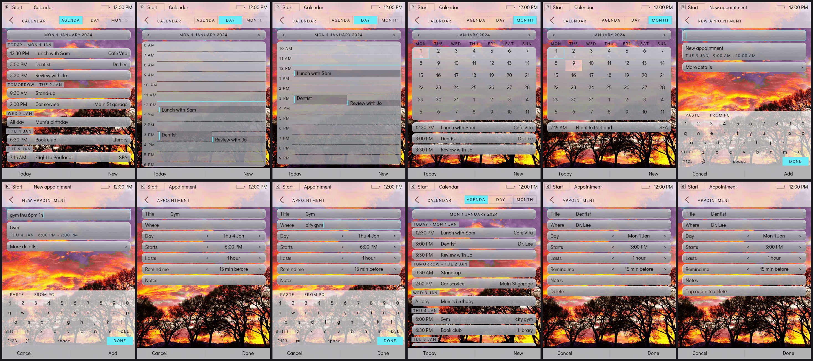
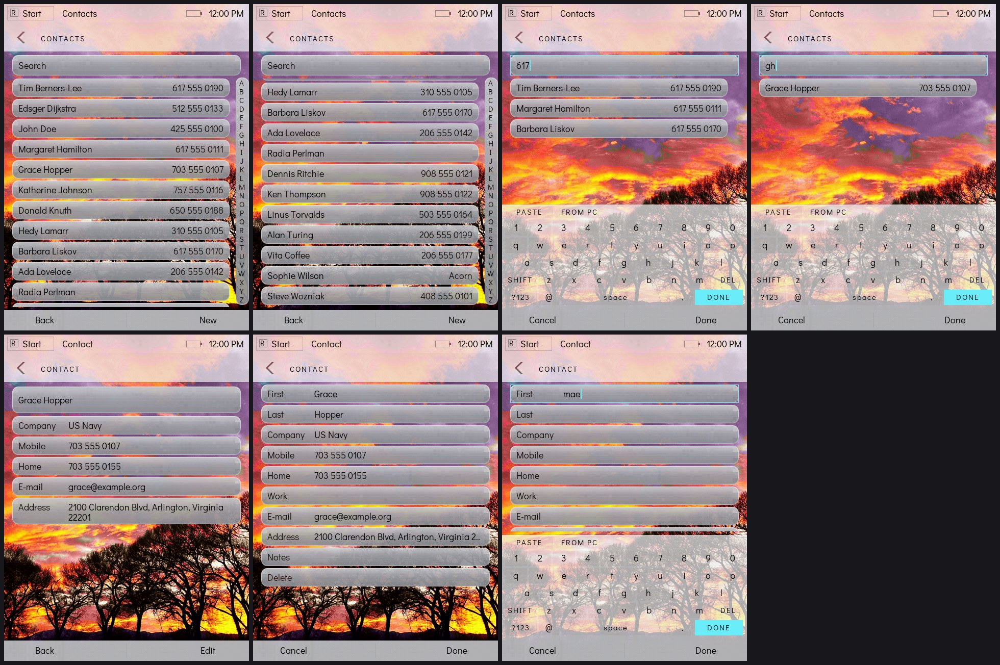
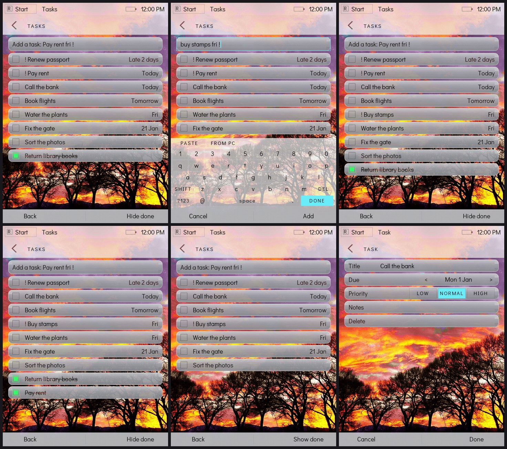
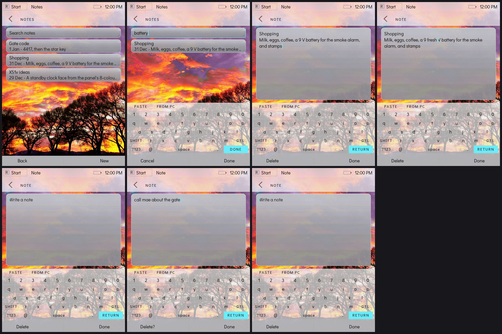
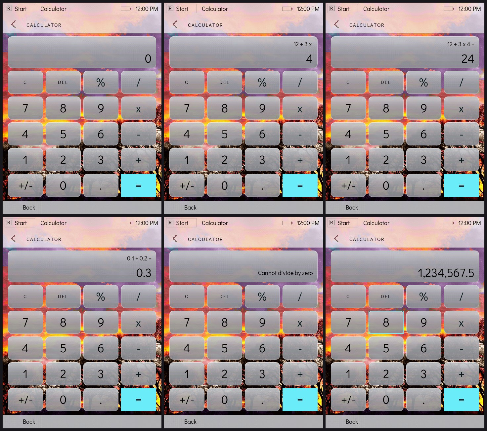
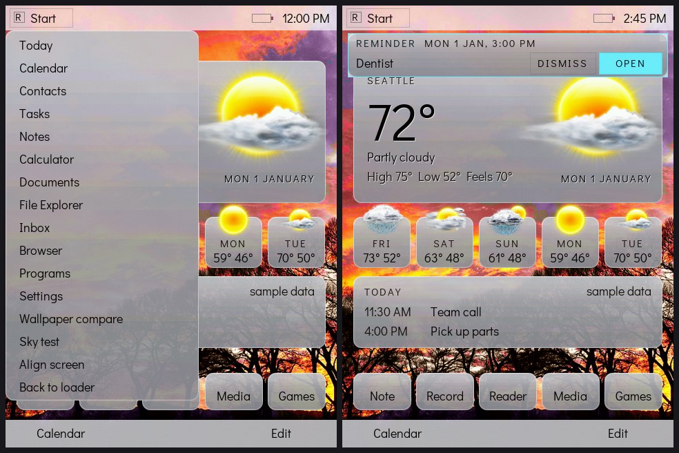

# Core apps, batch 1: the organiser (2026-11-13 night)

The owner's order of 2026-11-13: the checklist, the design language, and
the first five apps (Calendar, Contacts, Tasks, Notes, Calculator), each
with a Rule 0 sheet first, built, launchable from the Start menu, and
proven in the emulator. **No device run was made** (both Axims were out
cooling for the cold soak); the owner's morning test on the X51v is the
review gate, and by the project's rule nothing here "works" until that
test says so.

- Branch `fix/core-apps-2026-11-13`, cut from `main` at de678cd5.
  **Not pushed** (the order): on 2026-11-14 `git ls-remote origin` shows
  no such branch, and `main` at de678cd5.
- The checklist: [core-apps-list.md](../design/core-apps-list.md) (batch 1
  ticked in this report's commit). The look every app follows:
  [design-language.md](../design/design-language.md). Neither is repeated
  here.
- Every decision of the batch, each with the alternative weighed, as
  notes that wait on nothing:
  [decisions-2026-11-13-apps.md](decisions-2026-11-13-apps.md).
- Gate (`cargo xtask gate`, 2026-11-14): **30 of 30** architectural lines
  ticked for phases 2, 4 and 5 (lifted); no ledger row changed.

## What to do in the morning (after the cold tests)

1. `cargo xtask load rp-today` with the loader up, as for any Today run.
   The first run on your SD card makes the organiser's two files (2 MiB of
   zeros, once): the start is that much longer one time.
2. Start, then each of Calendar, Contacts, Tasks, Notes, Calculator. The
   store starts empty on your card; the pictures below show the apps with
   sample records.
3. Add something in each, go "Back to loader" from the Start menu, load
   again: what you added must be there. The run log's `organiser:` lines
   give the times (R197).
4. A reminder: add an appointment a few minutes ahead with "Remind me: at
   the start"; the banner must come up over whatever screen you are on.

## The commits

| Commit | What | `cargo xtask ci` on this PC |
|---|---|---|
| 981337b9 | Item 1: the checklist | passed |
| 1e3cd376 | Item 2: the design language | passed |
| 03ce866a | The shared crate `rp-pim` (store, dates, quick-add parser, calculator arithmetic) and its sheet [pim-store.md](../design/pim-store.md) | passed |
| f1e7a449 | The five Rule 0 sheets (docs only) | not run on it alone |
| c4838e66 | Items 3 to 8: the five apps in the shell, in the Start menu | **failed one test** (below), fixed in the next |
| e1fc9789 | The store on the SD card in rp-today; `cargo xtask emu-apps`; the Start menu fix | passed |
| 7a8db208 | rp-today's load budget for the look-check build; the picture sheets | passed (`7a8db208 clean`, 2026-11-14) |

CI here is `cargo xtask ci` on this PC (Windows): each pass is the line
`<commit> clean` it writes to `target/ci-pass.txt`. **There is no GitHub
run for this branch and no link to give:** the order says not to push, and
GitHub's workflow runs on a push. The last GitHub runs are `main`'s, on
de678cd5: [run 43551254092](https://github.com/Drakey83/retropane-os/actions/runs/43551254092),
conclusion success (2 h 26 min).

**What CI caught (c4838e66):** with twelve entries and the test image's
four, the Start menu was sixteen rows of 34 px. Its picture, open and
closed, then took 618 KB of the renderer's 614 KB area cache, each pushed
the other out, and every opening was drawn again:
`gpu_today_matches_the_cpu_renderer` counts the cache's hits and got 0.
That would have cost the 18 ms Start menu of 2026-11-12 on the device.
Rows are 33 px now (R198: 38 again when the test entries leave).

## How it was proven

- **`cargo xtask emu-apps`** (new; also in the full suite), the image in
  the emulator with an SD card image:
  - *Run 1.* The card holds 37 sample records in the store's own two
    files. The image loads them, and **all 39 screens of the five apps
    are compared pixel-exact with the PC's model** (only the title bar's
    clock is masked), driven by the same taps that draw the pictures
    below. Then the card image is read on the PC with the store's own
    code: the appointment, the task and the two note changes the taps made
    are on it (9, 18, 9 and 4 appointments, contacts, tasks and notes).
  - *Run 2.* The same card after a restart, its clock a minute before the
    Dentist's reminder: the banner comes up over Today, Open shows the
    appointment, and the Calendar, Tasks and Notes lists match a model
    whose store is read from that card. What was saved is what comes back.
  - Result on e1fc9789: OK. Run 1's log: `organiser: 40 records; the load
    read 5 sectors in 724 us; 5 sectors saved (slowest 36 us)`. Run 2's:
    `40 records; the load read 10 sectors in 808 us; 0 sectors saved`.
    **These times are the emulator's, not a card's.**
- **`cargo xtask emu-today`** on e1fc9789 (the Today image's own check:
  the organiser's start-up work must not disturb it): Today pixel-exact
  and up after 40 s idle, the Start menu pixel-exact, the align screen,
  Weather on the plane path, the 28-press replay and the profile, all OK.
  Its last part, the look check, refused the look-check build for size
  (1,564 B over); 7a8db208 raises the test image's budget, and the look
  check passed on it (below).
- **The full emulator suite** (`cargo xtask emu`, emu-apps included) on
  7a8db208, 2026-11-14: **passed** (exit 0). Its fifth check, the
  kernel's quantum test (timing, in code this batch never touched), ran
  out of time on the first try while the PC was busy; the suite was
  resumed at that check (`RETROPANE_EMU_FROM=boot_quantum`, the suite's
  own way after such a stop) and it and every check after it passed,
  `today OK` and `apps OK` among them. So: checks 1 to 4 from the first
  run, 5 to the end from the second, the same commit and build.
- **`emu-today-radar-card` and `emu-today-look`** (parts of `emu-today`
  the suite doesn't run) on 7a8db208: both passed (`today look OK`).
- **Tests in the codebase's practice:** 32 in `rp-pim` (a power cut after
  every write of a change and of a slot's move, full slots, junk and stale
  groups, every day from 1970 to 2100, the typed line's edges, decimal
  sums binary floats get wrong, the calculator's keys); 14 in the shell
  for the apps through its own inputs (each named in the sections below);
  5 in rp-today for the card (FAT32 and exFAT: a restart, a full slot's
  move, a dead card and its retry, a slot file a PC left short, the shared
  card's other files).
- **What the emulator cannot prove**, and the morning test can: the feel
  of the keys and the letter strip under a stylus, the glass and type on
  the panel, and a real SD card's write times.

## Calendar

- **Sheet:** [calendar-rule0.md](../design/calendar-rule0.md).
- **Built:** three views on one chip row. *Agenda* (the first view): from
  today, 60 days ahead, a label per day that has something. *Day:* the
  hours, appointments as blocks, side by side when they overlap; a tap on
  an empty hour starts a new one there. *Month:* dots on the days that
  have something, today ringed, the chosen day's list under the grid.
  *New* is one typed line ("gym thu 6pm 1h") that shows what it understood
  before Add; "More details" opens the editor (title, where, day, start,
  length, reminder, notes; Delete asks in place). *Reminders* come up as a
  banner over any screen, the notification centre's first piece, with
  Dismiss and Open. No sync, no accounts, no network.
- **Emulator proof:** screens a02 to a13 (twelve) pixel-exact; the Gym
  appointment added by the typed line and its place typed in the editor
  read back from the card and shown after the restart; the reminder banner
  and its Open in run 2. Tests: `quick_add_keeps_the_appointment_it_previewed`,
  `the_three_calendar_views_show_the_same_day`,
  `a_reminder_shows_once_on_any_screen_and_is_dismissed_or_opened`,
  `a_reminder_missed_while_off_shows_at_the_load_unless_the_time_has_passed`,
  `the_day_turning_moves_the_agenda_on`.
- **Cut to the later list:** week view, repeating appointments, snooze and
  a reminder sound, time zones, categories, search, iCal files, drag to
  move, and Today's own calendar panel fed from the store (**Today still
  shows its two sample lines**, "Team call" and "Pick up parts": wiring it
  is outside the five apps).
- **For the morning:** agenda first; a weekday means the coming one, today
  included; 15-minute reminder and one hour by default; Monday starts the
  week; slashed dates read month first.

## Contacts

- **Sheet:** [contacts-rule0.md](../design/contacts-rule0.md).
- **Built:** the list sorted by last name and shown "First Last", the
  first number on the right, a letter strip on the edge (one tap to a
  letter), and a search field that filters at each key and also matches
  initials ("gh") and phone digits ("617"). A card shows only the fields
  that are filled; the editor has nine rows, and the keyboard's Done goes
  to the next one. It shares the one store with the other three apps.
- **Emulator proof:** screens a14 to a20 (seven) pixel-exact, the 18
  sample contacts loaded from the card. Tests:
  `contacts_file_by_last_name_and_search_finds_digits_and_initials`,
  `the_keyboards_done_goes_down_a_contacts_fields`.
- **Cut to the later list:** photos, vCard in and out, birthdays, more
  phones and labels, groups, beaming, names beyond ASCII on screen.
- **For the morning:** whether the 17 px strip letters suit your stylus
  (the sheet's fallback is 13 pairs at 34 px).

## Tasks

- **Sheet:** [tasks-rule0.md](../design/tasks-rule0.md).
- **Built:** one list ordered by urgency (late first, then by due date,
  done at the bottom, dimmed), a box to complete or reopen, due dates in
  words ("Tomorrow", "Late 2 days"), an add field that reads a typed line
  ("buy stamps fri !": Friday, high priority), Hide done on the softkey,
  and an editor with a due stepper and priority chips.
- **Emulator proof:** screens a21 to a26 (six) pixel-exact; "buy stamps"
  and Pay rent's tick read back from the card and shown after the restart.
  Test: `tasks_order_by_urgency_and_the_box_completes_and_reopens`.
- **Cut to the later list:** tasks in the Calendar's agenda, repeating
  tasks, task reminders, categories, subtasks, Today's tasks line.
- **For the morning:** there is no sort menu; say if you want your own
  order.

## Notes

- **Sheet:** [notes-rule0.md](../design/notes-rule0.md).
- **Built:** the list newest first with each note's first line and the
  start of the rest, a search field over every note's whole text, and an
  editor that wraps text, moves the caret to a tap, and keeps the note on
  every way out (there is no Cancel; Delete asks once). Today's Note
  button starts a new note at once.
- **Emulator proof:** screens a27 to a32 and a39 (seven) pixel-exact; the
  new note and the words typed into an old one read back from the card and
  shown after the restart. Test:
  `a_note_keeps_itself_on_every_way_out_and_edits_at_the_caret`.
- **Cut to the later list:** ink and handwriting (batch 6), voice notes
  (batch 5), notes over 2,000 bytes, undo, folders, text files.
- **For the morning:** no Cancel in a note is the choice most likely to
  surprise; the alternative is in the notes file.

## Calculator

- **Sheet:** [calculator-rule0.md](../design/calculator-rule0.md).
- **Built:** twenty keys of 106 x 70 px, a display that shows the sum
  above the number, exact decimal arithmetic to 12 digits (0.1 + 0.2 is
  0.3), the order of operations school teaches (2 + 3 x 4 is 14), errors
  in words ("Cannot divide by zero"), and every key reachable by the D-pad.
  History: the sum just worked stays above its answer until the next key;
  there is no tape.
- **Emulator proof:** screens a33 to a38 (six) pixel-exact, the D-pad's
  focus among them. Tests: `the_calculators_keys_work_by_tap_and_by_the_d_pad`
  and `rp-pim`'s eleven arithmetic tests.
- **Cut to the later list:** scientific mode, conversions, a history tape,
  memory keys, parentheses, copy and paste, other regions' digit marks.
- **For the morning:** precedence instead of Windows Mobile's
  key-by-key answers; no memory keys.

## All five (item 8)

- **In the Start menu:** Today, Calendar, Contacts, Tasks, Notes,
  Calculator, then the rest. Screen a01, and
  `the_start_menu_opens_each_app_and_home_leaves_it`.
- **The design language:** one frame, one accent, glass panels, 36 px
  rows; `every_screen_fits_a_frame_its_targets_are_big_enough_and_the_d_pad_reaches_them`
  holds every screen of every app to a draw list of one frame, targets of
  at least 30 px, and the D-pad reaching each; `a_drag_scrolls_a_list_and_is_not_a_tap`.
- **Without their memory or a card** the apps say so and the calculator
  still works (`without_memory_the_apps_say_so_and_the_calculator_still_works`).

## Found on the way, not part of the five apps

- **R200:** a D-pad button held across the tick counter's 22-minute wrap
  doesn't repeat (read in the key code while writing `emu-apps`; not hit,
  not fixed).
- **R196:** three commits on `fix/x50v-usb-2026-11-13` are on no other
  branch (your call: merge or cherry-pick).
- `emu-apps` holds buttons in the PC's time: an idle image's clock, as
  the emulator's monitor reads it, moves only when the image wakes, so a
  "150 ms" hold lasted a second and the D-pad repeated. The Today check's
  Home press is held the same way; it is harmless there (Home doesn't
  repeat) and was left alone.

## Reminders

Opened: R196 to R200 (R195 copied word for word from the X50v branch so
the numbers agree). Due now: none came due in this batch (no device run,
no test-image load); R197 (the store's times on the real card) comes due
at the morning's first `rp-today` load, with the reminders that load
already carries. 125 open of 200.

## Earlier reports' headers (docs/reports/README.md rule 4)

Checked 2026-11-14: `origin/main` is de678cd5, where the 2026-11-13 merge
records put it; no earlier report's push or merge claim has been
overtaken since.
